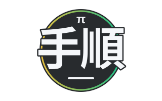

# Pi Tejun



Pi Tejun is a project for turning recurring agent tasks into reusable workflows
built around the [Pi harness](https://pi.dev). The goal is to define how a task
should run once, then invoke it by name or let it run on an approved schedule or
event, with results saved where they belong.

## The problem

A recurring task involves more than its prompt. Reviewing projects, researching
a topic, or preparing content also requires choosing inputs, supplying context,
setting boundaries, checking earlier results, and deciding where to save the
output. Repeating those instructions in interactive sessions leaves the user
responsible for coordinating each run.

Separate scripts and saved prompts can help, but each can introduce a different
way to start work, manage context, and collect results. Automating them also
raises questions about authority, repeated runs, failures, and supervision.
Pi Tejun aims to make those concerns explicit and consistent across workflows.

## The intended approach

Each named workflow should describe its purpose, required inputs, allowed
effects, and output destination. Shared execution support should make it
possible to:

- Discover and invoke workflows from the terminal without navigating to their
  implementation directories or reconstructing instructions.
- Run suitable workflows on approved schedules or events, within defined
  authority and execution limits.
- Save results in known locations, with successful, incomplete, and failed runs
  clearly distinguishable.
- Use relevant history without silently resuming an unrelated interactive
  session or repeatedly ignoring earlier user decisions.

The same workflow boundaries should apply whether a run starts manually or
automatically. Routine work should not require continuous supervision, and
results should be available for review at the desk.

Initial use cases include cross-project reviews, sourced discovery digests,
content-topic research and preparation, and exploration of recording analysis
and editing assistance. These are individual workflows, not a required pipeline.

## What belongs here

Pi Tejun owns reusable workflow definitions, workflow-specific instructions,
and shared execution support. Research, generated results, and user decisions
stay in their dedicated project or content locations.

The separate Pi-Kijun project defines the authoritative Pi harness setup and
general working standards. Pi Tejun uses that setup rather than duplicating it.
Automation does not itself authorize source changes, project acceptance, Git
operations, or publication.

## Get started

You need Python 3.11 or newer, `pi` and `herdr` on `PATH`, an activated Kijun
agent directory, and working Pi credentials. The configured agent directory
must contain `AGENTS.md` and `extensions/herdr-agent-state.ts`; the `verify`
workflow also needs the `unslop` skill. The current setup was checked with
Pi 1.5.0 and Herdr 0.9.1.

From this repository, install the user-level command:

```sh
python3 install.py
```

The installer creates `~/.local/bin/tejun` as a link to this checkout. Keep the
checkout in place. On first installation, it creates local configuration at
`~/.local/share/pi-tejun/config.toml` using your saved Pi provider, model, and
thinking defaults. It also creates a verification workspace with `input.md`.
Existing local configuration is preserved. The installer refuses unrelated
command collisions and does not change Pi settings or shell startup files.

If `~/.local/bin` is not already on `PATH`, add it for the current terminal:

```sh
export PATH="$HOME/.local/bin:$PATH"
```

Review the local configuration before running anything. `[pi]` selects the
agent directory, provider, exact model, thinking level, Herdr status extension,
and workflow timeout. Keep credentials in Pi, not in this file. Workflow
`[model]` fields override these defaults. In particular, `verify` currently
selects `openai/gpt-6.1-sol` with `low` thinking; check access before using it.
The simpler `content-smoke-test` uses your local defaults.

For the smoke test, add this entry to the existing `[paths]` table in
`~/.local/share/pi-tejun/config.toml`:

```toml
content_production = "~/dev/default/content-production"
```

The destination must already exist. Then run from a terminal inside Herdr,
without needing to attach to the workflow session:

```sh
mkdir -p ~/dev/default/content-production
cd /tmp
tejun list
tejun run content-smoke-test
```

Tejun starts or reuses a dedicated headless Herdr session named `tejun`. It
creates fresh Pi TUI agents without attaching or changing your terminal's
focus. Launch acknowledgement waits for startup, not for the workflow to finish.

## Usage and results

```sh
tejun list
tejun run content-smoke-test
tejun run verify
tejun run
```

`list` shows each workflow's purpose, enabled state, and resolved output
location. `run NAME` can launch a named workflow even when it is shown as
`disabled`. The `enabled` list in local configuration applies only to bare
`tejun run`, which initially selects `verify`.

Read the definitions in `workflows/` before invoking a workflow. They declare
inputs, allowed effects, and output locations. `content-smoke-test` needs no
input file and writes a fixed short Markdown result directly to
`[paths].content_production`. `verify` reads `input.md` under
`[paths].verification` and saves its heading followed by the input text under
that workspace's `reports/` directory. It first produces a longer diagnostic
review in the Pi conversation, not in the output file. You can edit the local
`input.md` to supply different verification text.

Each invocation prints its expected result path and the path to its local
`status.json`, normally under `~/.local/state/pi-tejun/runs/`. A launch message
means completion is pending. Inspect the status file for the final outcome and
`worker.log` in the same run directory for diagnostics. Only `state: success`
confirms completion. A missing final outcome is unconfirmed work, not success.
`TEJUN_CONFIG` and `TEJUN_STATE_DIR` can override the local config and state paths.

Output names include the workflow and a unique run identifier. The launcher
reserves a new, empty `.partial.md` file before starting Pi. After exact-content
validation and confirmed Pi exit, it publishes the final `.md` file without
replacing any existing name, then removes the partial name. Publication uses
an atomic hard link in the same directory, so the destination filesystem must
support hard links. Existing run records and partial files are also preserved.
Successful runs close their unchanged workflow tab. Cleanup errors are recorded
without relabelling a published result as failed.

All selected workflows undergo local input, configuration, and resource checks
before session startup. Validation errors return diagnostics without launching
an agent. Handled launch failures record `failed` once a run record exists;
later execution failures record `incomplete`. Blocked or unsettled agents and
invalid results remain available for diagnosis. Session startup diagnostics go
to `~/.local/state/pi-tejun/herdr-server.log` by default.

SIGINT or SIGTERM interruption of the launcher before worker handoff, or of
the worker before publication, records an incomplete outcome where a run
exists. Interrupting the worker does not necessarily stop its Pi agent. After
successful worker handoff, work continues independently of the caller. SIGKILL
and machine failure cannot produce a final status update; a run left at
`started` or `working` is unconfirmed, not successful. Preserve its diagnostics
and partial output until inspected.

Do not treat a partial file, an old output, or a launch acknowledgement as a
newly completed result. The launcher does not accept results or authorize
source changes, Git work, or publication. Workflow instructions are not
filesystem or network access controls.

## History and overlapping runs

Every run starts a fresh Pi conversation with explicitly selected resources.
There is no automatic session continuation or loading of previous run records.
Workflow definitions may declare optional, workspace-relative `history_inputs`
files. The launcher checks that they are readable and includes their resolved
paths in the prompt for Pi to read as data. It does not decide what the history
means, maintain a digest index, or update domain decisions.

Runs that write only their unique result files can overlap, including in the
same directory. A workflow that shares mutable files must declare their exact,
workspace-relative paths in `exclusive_paths`. All workflows using the same
shared mutable file must declare it consistently. These are file reservations,
not directory-tree locks or restrictions on tool access. Their complete rules
and recovery procedure are in the
[execution contract](docs/manual-execution-contract.md#history-and-overlap-policy).

Conflicting runs are rejected rather than queued. Reservations are released
after confirmed Pi exit, or after a launch failure before agent startup was
attempted. If an agent might still be running, reservations remain, even after
a worker exits or is killed. Before manually removing a reservation, inspect
its owner record and confirm that both its worker and Pi agent have stopped.
Coordination requires the same Tejun state directory; separate state directories
or hosts do not share reservations.

## Validation

Run the credential-free checks from this repository:

```sh
PYTHONDONTWRITEBYTECODE=1 python3 -m unittest discover -s tests -v
node --test tests/workflow-check.test.mjs
PYTHONDONTWRITEBYTECODE=1 python3 tests/probes/s001-pi-contract.py
```

The extension tests require Node with built-in TypeScript type stripping. The
Python suite includes disposable subprocess signals, cross-process reservations,
concurrent session initialization, and an installed CLI plus detached worker
using fake Herdr outside the repository. It does not start a real workflow or
contact a model provider.

## Project status and documentation

B001 and its slices S001 through S005 are complete. Manual discovery,
installation, background execution, failure handling, repeatability, and
shared-file coordination are implemented. The user verified the S002 smoke test inside and
outside this repository; S003/S004 add credential-free failure and concurrency
checks. S005 adds installed-command checks for both definitions, a tested
workflow-authoring example, and combined B001 verification evidence. Both S005
and B001 passed the user-delegated acceptance review. The runner currently
validates exact-content Markdown only. Scheduled execution and domain workflows
are not implemented.

- [Workflow authoring](docs/workflow-authoring.md) explains supported definition
  fields, local configuration, exact-result validation, and adding a workflow
  through the existing command.
- [B001 verification evidence](docs/b001-verification.md) maps manual invocation
  behavior and reproducible checks to all six brief acceptance criteria.
- [Project charter](docs/project/charter.md) defines the purpose and boundaries.
- [Manual execution contract](docs/manual-execution-contract.md) records the
  launcher model and manual integration evidence.
- [Work index](docs/project/work.md) lists the briefs and their current status.
- [Work records](docs/project/work/) contain outcomes, acceptance criteria, and
  open questions.
